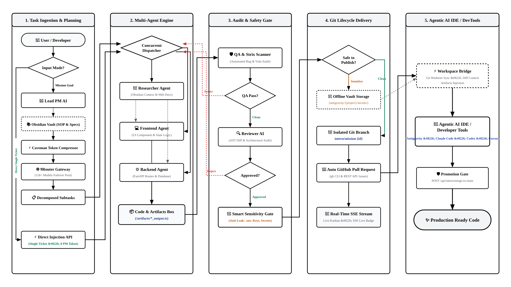
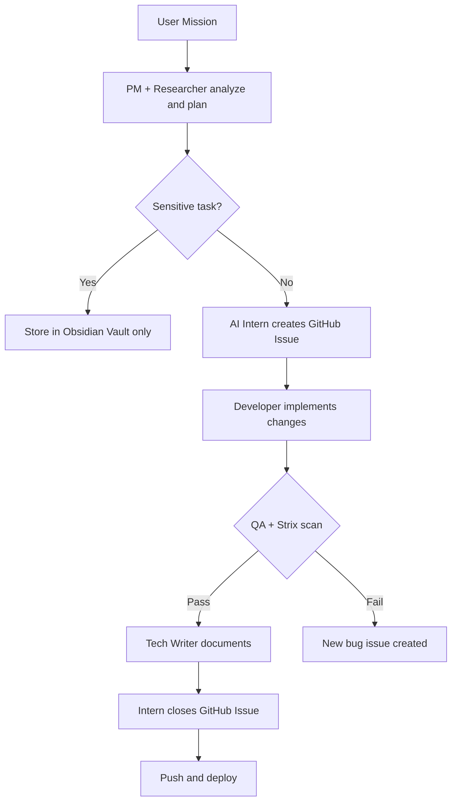

# 🎭 TUYUL Orchestra — Task Unified Yield & Utility Layer

<div align="center">

**A revolutionary 3D virtual office where autonomous AI agents work together as an orchestrated workforce**

[](https://www.typescriptlang.org/)
[](https://reactjs.org/)
[](https://threejs.org/)
[](https://vitejs.dev/)
[](https://www.python.org/)
[](https://fastapi.tiangolo.com/)
[](https://cli.github.com/)

</div>

---

## 🌟 Overview

**TUYUL** (**T**ask **U**nified **Y**ield & **U**tility **L**ayer) **Orchestra** is not just another AI chatbot — it's a **complete autonomous AI workforce coordination system** that simulates a real software development office in stunning 3D. Watch as specialized AI agents with different roles, authorities, and capabilities collaborate to complete complex tasks — complete with parallel execution, 9Router cost prediction, GitHub issue tracking, Strix security scanning, and Obsidian knowledge research.

### 🎯 Core Concept

**Traditional AI Agents**: Single AI model answering questions  
**TUYUL Orchestra**: A full virtual office where specialized AI agents work together with hierarchy, authority levels, and escalation protocols

Think of it as a **virtual software company** where:
- 🎩 **Product Manager** — Decomposes PRD, dispatches tasks, reviews output (Authority: 10)
- 🔬 **AI Research Specialist** — Pulls context from Obsidian Vault to save PM tokens (Authority: 5)
- 💻 **Frontend Engineer** — Builds UI components and consumes backend APIs (Authority: 4)
- ⚙️ **Backend Engineer** — Owns REST API, schema, auth, and data logic (Authority: 4)
- 🧪 **QA Engineer** — Regression testing + Strix security scanning (Authority: 3)
- 👀 **Reviewer** — Architecture conformance and code standard audit (Authority: 6)
- 🎓 **Intern** — Git safety SOP, docs, GitHub issues, Obsidian wikilinks (Authority: 1)

> The workforce is deliberately pruned to **7 functional roles**. Non-functional roles (`architect`, `strategist`, `developer`, `devops`, `planner`, `security`) were removed in commit `8d2808f` — see [src/types/office.ts](src/types/office.ts).

---

## ✨ Key Features

### 🏢 Immersive 3D Virtual Office
- **Real-time 3D rendering** with Three.js
- Beautiful office environment with dedicated work zones (Orchestra Pod, Engineering Bay, QA & Docs Studio)
- Live animated characters representing each AI agent
- Smooth camera controls with 360° rotation
- Performance-optimized rendering (60 FPS target)

### 🤖 Intelligent Agent System
- **Authority-based hierarchy** (0–10 levels)
- **Dynamic model selection** — Uses budget models for simple tasks, premium models for complex ones
- **Escalation protocols** — Lower authority agents can escalate to higher authority
- **Context-aware execution** — Each agent receives only relevant information
- **Review loops** — Multi-layer quality control (Plan → Execute → Test → Review)

### 🔬 AI Research Specialist (Dr. Aris Thorne)
- Dedicated AI agent supporting the Product Manager with knowledge retrieval
- Searches Obsidian Vault for relevant project notes and SOPs
- Reduces PM token consumption on repetitive knowledge tasks
- Integrated into the Orchestra Pod layout alongside the PM desk

### 🔐 Security Gate — Smart Sensitivity Filter
- PM and AI Intern automatically evaluate task sensitivity before creating public GitHub issues
- Tasks with sensitive keywords (`.env`, `api_key`, `secret`, `token`, `password`, `credential`, `private_key`) are **blocked from public GitHub** and kept in Obsidian Vault
- Transparent audit trail — all blocked tasks are logged with their reason

### 🛡️ Strix Autonomous Security Scanner
- **QA Agent** is powered by [Strix](https://strix.sh) for autonomous bug discovery and penetration testing
- Dynamically reads the active AI model from the QA agent and routes it through **9Router Gateway**
- Runs asynchronously in the background after each QA simulation tick
- Results surfaced via `/api/qa/strix-scan` endpoint

### 📋 Issue-Driven Development (IDD) with GitHub CLI
- AI Intern creates GitHub Issues **before** implementing changes via `gh` CLI
- Issues include rich metadata: `assignees`, `labels`, `milestones`
- PM evaluates sensitivity before allowing public issue creation
- Full issue lifecycle: Create → Work → Close → Push

### 🎛️ Real-time Orchestration
- Live task board with Kanban-style workflow
- Activity feed showing only task-relevant events (no noise)
- Agent status monitoring (Idle, Planning, Coding, Testing, Reviewing, Blocked)
- Mission progress tracking
- Cost optimization through smart model routing via 9Router

### 📡 Observability & Health Telemetry
- Dedicated **Telemetri** tab showing live gateway health, not a static assumption
- `/api/health` actually pings `9Router /v1/models` and reports `gateway_ok`, `gateway_latency_ms`, and backend `uptime_seconds`
- Per-model table: call count, failures, real token in/out from the API response `usage` field, average and last latency
- SSE stream state surfaced separately from gateway state, so a dead gateway can no longer hide behind a green "SSE LIVE" badge
- In-memory session stats with a manual reset; no external metrics service required

### 🔄 Backend Integration
- **FastAPI** backend for AI orchestration
- **9Router** integration for multi-provider AI access (OpenAI, Anthropic, Gemini, DeepSeek, Ollama)
- **Obsidian** vault integration for knowledge management and SOP storage
- **GitHub CLI** (`gh`) for automated issue management
- Automated documentation generation

---

## 🛠️ Tech Stack

### Frontend
- **React 19** - Modern UI framework
- **TypeScript** - Type-safe development
- **Three.js** - 3D graphics and rendering
- **Tailwind CSS 4** - Modern styling system
- **Zustand** - State management
- **Vite** - Lightning-fast build tool
- **Motion** - Smooth animations
- **Lucide React** - Beautiful icons

### Backend
- **Python 3.11+** — Backend runtime
- **FastAPI** — High-performance API framework
- **9Router** — Multi-provider AI gateway
- **GitHub CLI (`gh`)** — Automated GitHub issue creation
- **Strix Agent** — Autonomous security & bug scanning
- **python-dotenv** — Environment management

### 3D & Graphics
- **Three.js 0.186** - WebGL rendering
- **OrbitControls** - Camera manipulation
- **Custom shaders** - Optimized materials
- **Shadow mapping** - Realistic lighting

---

## 🚀 Quick Start

### Prerequisites
- **Node.js** 18+ and npm/bun
- **Python** 3.11+ (for backend)
- **GitHub CLI** (`gh`) — [Install here](https://cli.github.com/) and run `gh auth login`
- **9Router** running locally on port `20128`
- Modern browser with WebGL support

### Installation

1. **Clone the repository**
```bash
git clone https://github.com/Inineo/TUYUL-Orchestra.git
cd TUYUL-Orchestra
```

2. **Install frontend dependencies**
```bash
npm install
# or
bun install
```

3. **Install backend dependencies**
```bash
cd backend
pip install -r requirements.txt
cd ..
```

4. **Configure environment variables**
```bash
cp .env.example .env
```

Edit `.env` and fill in your credentials (see `.env.example` for all options):
```env
# 9Router Configuration
VITE_9ROUTER_URL=http://localhost:20128
VITE_9ROUTER_API_KEY=your_api_key_here

# Default AI Model (routed via 9Router)
DEFAULT_AI_MODEL=openai/gpt-4o-mini

# Obsidian Integration (optional but recommended)
OBSIDIAN_ANTIGRAVITY_PATH=D:\Obsidian\YourVault\antigravity
CURRENT_PROJECT_NAME=Kibi-Orchestra
```

> ⚠️ **Never commit your `.env` file.** It is already in `.gitignore`. Only `.env.example` (with empty values) is tracked.

5. **Authenticate GitHub CLI** (required for AI Intern to create issues)
```bash
gh auth login
```

6. **Start the development server**

**Frontend:**
```bash
npm run dev
```
Open http://localhost:3000

**Backend** (database auto-initializes on first run):
```bash
cd backend
python main.py
```
Backend runs on http://localhost:8000

> 💾 **Database**: `orchestrator.db` is created automatically in `backend/` when the server starts for the first time. No manual setup required. It is excluded from git via `.gitignore`.

---

## 📖 Usage

### Creating a Mission

1. Click the **"New Mission"** button in the command center
2. Enter your mission description (e.g., "Add authentication with JWT")
3. Watch as the Orchestra Maestro analyzes and delegates tasks
4. Monitor real-time progress in the 3D office

### Interacting with Agents

- **Click on an agent** to view their current task and status
- **Hover over desks** to see agent roles and activity
- **Use the task board** to track workflow progress
- **Check the event stream** for detailed activity logs

### Camera Controls

- **Left Click + Drag**: Rotate camera
- **Right Click + Drag**: Pan camera
- **Mouse Wheel**: Zoom in/out
- **Double Click Agent**: Focus camera on agent

---

## 🏗️ Project Structure

```
Kibi-Orchestra-V3/
├── src/
│   ├── components/
│   │   ├── office3d/           # 3D office scene components
│   │   │   ├── ThreeOfficeScene.ts  # Main 3D engine
│   │   │   └── OfficeCanvas.tsx     # React wrapper
│   │   ├── panels/             # Telemetry dashboard (StatsPanel)
│   │   ├── modals/             # Modal dialogs
│   │   ├── simple/             # Simple UI components (Kanban, ActivityFeed, AgentSettings)
│   │   └── ui/                 # Reusable UI primitives
│   ├── stores/
│   │   └── useOfficeStore.ts   # Zustand global state + agent simulation
│   ├── types/
│   │   └── office.ts           # TypeScript type definitions (AgentRole etc.)
│   ├── data/
│   │   └── initialData.ts      # Default agent configurations
│   └── lib/
│       ├── utils.ts            # Utility functions
│       ├── aiClient.ts         # AI client integration (9Router) + call instrumentation
│       └── telemetry.ts        # In-memory per-model stats (calls, errors, tokens, latency)
├── backend/
│   ├── main.py                 # FastAPI server (all routes)
│   ├── config.py               # Configuration management
│   ├── requirements.txt        # Python dependencies
│   ├── services/
│   │   ├── orchestrator.py     # AI workflow orchestration (PM + Researcher)
│   │   ├── obsidian.py         # Obsidian vault read/write integration
│   │   ├── intern_safety.py    # GitHub issue creation + sensitivity gate
│   │   ├── qa_strix.py         # Strix autonomous security scanner integration
│   │   └── caveman.py          # Token compression utility
│   └── scripts/                # Setup & sync utility scripts
├── .env.example                # Environment template (safe to commit)
├── .gitignore                  # Excludes .env, secrets, vault paths
└── package.json
```

---

## 🎨 3D Office Design

The virtual office features three distinct zones:

### 🎭 Orchestra Pod (Center)
- **Product Manager (PM)** — Strategic command and task delegation
- **AI Research Specialist (Dr. Aris Thorne)** — Knowledge research supporting the PM
- Panoramic curved monitors for system-wide overview

### 💻 Engineering Bay (Left Wing)
- **Frontend & Backend Developers**
- Dual-monitor workstations
- Collaborative development zone

### 📋 Quality & Docs Studio (Right Wing)
- **QA Engineer** — Powered by Strix autonomous security scanner
- **Technical Writer** — Documentation workspace
- Quality assurance and knowledge hub

---

## 🧠 Agent Roles & Authority

| Role (code) | Authority | Default Model | Responsibilities |
|-------------|-----------|---------------|------------------|
| **Product Manager** (`product_manager`) | 10 | `Architect` | PRD decomposition, dispatch, review gate, final approval |
| **Reviewer** (`reviewer`) | 6 | `Coding_Specialist` | Architecture conformance, code standard audit |
| **AI Research Specialist** (`researcher`) | 5 | `Fast` | Knowledge retrieval, Obsidian search, PM context support |
| **Frontend Engineer** (`frontend`) | 4 | `Daily` | UI components, responsiveness, API consumption |
| **Backend Engineer** (`backend`) | 4 | `Coding_Specialist` | REST API, schema, auth, data logic |
| **QA Engineer** (`qa`) | 3 | `Tester` + Strix | Regression testing, edge cases, security scan |
| **Intern** (`intern`) | 1 | `Fast` | Git safety SOP, docs, GitHub issues, Obsidian wikilinks |

**Key Principle**: Lower authority cannot override higher authority decisions — they must escalate!

---

## 🔐 Security Policy

### What Is Protected
- Real `.env` files are excluded via `.gitignore` — never tracked
- No API keys, tokens, or credentials are hardcoded in source files
- Sensitive tasks (involving `api_key`, `secret`, `token`, `.env`, `password`, `credential`, `private_key`) are **intercepted by the Security Gate** and stored in Obsidian Vault instead of public GitHub Issues

### What Is Safe to Commit
- `.env.example` — template with empty values ✅
- All source code — no hardcoded secrets ✅
- `backend/config.py` — reads from environment variables only ✅

### Git History Audit
## 🏛️ System Architecture

<div align="center">
  <a href="docs/architecture-diagram.svg">
    
  </a>
  <p><em>(Klik gambar di atas untuk membuka visual SVG high-definition skala penuh 1920×1080)</em></p>
</div>

<details>
<summary><b>🔍 Rincian 5-Stage Pipeline Arsitektur</b></summary>

1. **Stage 1: Task Ingestion & Planning**
   - **Lead PM AI**: Membaca SOP dari Obsidian Vault lokal.
   - **Caveman Compressor**: Memangkas token prompt hingga ~60% sebelum dikirim ke gateway.
   - **9Router Gateway**: Orchestrasi failover ke pool 118+ model AI.
   - **Direct Injection API**: Bypass 0-token untuk inject task langsung via `@tag`.

2. **Stage 2: Concurrent Multi-Agent Engine**
   - **Concurrent Dispatcher**: Membagi subtask ke agent spesialis secara paralel.
   - **Researcher Agent**: Ekstraksi dokumentasi dan context notes.
   - **Frontend & Backend Agents**: Menulis kode dan menyimpan artefak ke `/artifacts/*`.

3. **Stage 3: Multi-Layer Audit & Safety Gate**
   - **QA / Strix Scanner**: Security penetration testing & regression test otomatis.
   - **Reviewer AI**: Verifikasi kesesuaian arsitektur & standar kode.
   - **Smart Sensitivity Gate**: Mencegah kebocoran kredensial atau task privat ke GitHub publik.

4. **Stage 4: Git Lifecycle Delivery**
   - **Offline Vault**: Menyimpan task sensitif secara terisolasi di Obsidian lokal.
   - **Branching**: Pembuatan branch otomatis `intern/mission-*` dan GitHub PR.
   - **Real-Time SSE**: Notifikasi live event stream ke Kanban dashboard.

5. **Stage 5: Agentic AI IDE / DevTools Integration**
   - **Workspace Bridge**: Sinkronisasi Git worktree & artefak kode ke IDE agentic (Antigravity, Claude Code, Cursor, Codex).
   - **Production Promotion Gate**: Verifikasi akhir sebelum merge ke branch `main`.

</details>

---

## 🎯 Workflow: Issue-Driven Development (IDD)



---

## 🔧 Backend API Endpoints

### System & Events
- `GET /api/health` — Live gateway ping, latency, uptime
- `GET /api/events/stream` — SSE event bridge (task + PR lifecycle)

### Mission & Task Management
- `POST /api/missions/decompose` — PM breaks a goal into subtasks
- `POST /api/missions/review` — PM review gate
- `GET /api/missions` / `GET /api/missions/{mission_id}` — Mission records
- `POST /api/tasks` — Hybrid single-ticket dispatch (bypasses PM, 0 extra PM tokens)
- `GET /api/tasks` — List tasks
- `PATCH /api/tasks/{task_id}/status` — Update task status
- `POST /api/tasks/{task_id}/complete` — Complete task + persist artifact

### Agent & Memory
- `POST /api/agents` / `GET /api/agents` — Agent registry
- `GET /api/agents/{agent_id}/memory` — Task history + artifact summary
- `POST /api/artifacts` — Save artifact
- `GET /api/artifacts/task/{task_id}` / `GET /api/artifacts/mission/{mission_id}` — Artifact lookup

### Git Lifecycle (Intern)
- `POST /api/intern/github-issue` — Create GitHub issue via `gh` CLI
- `POST /api/intern/missions/{mission_id}/commit-and-push` — Commit + push on mission branch
- `POST /api/intern/missions/{mission_id}/create-pr` — Open PR with security gate
- `POST /api/intern/missions/{mission_id}/merge-to-main` — Guarded promotion to `main`

### QA & Security
- `POST /api/qa/strix-scan` — Run Strix autonomous security scan

### Obsidian Integration
- `GET /api/obsidian/notes` / `GET /api/obsidian/notes/{filename}` — Read notes
- `POST /api/obsidian/notes` — Write note
- `POST /api/projects/init` — Scaffold project folders (`plan/`, `conversation/`, `docs/`)

---

## 📊 Performance Optimizations

### 3D Rendering
- ✅ Shadow map resolution reduced to 1024 (4x lighter on VRAM)
- ✅ Pixel ratio capped at 1.25 on high-DPI screens
- ✅ Raycasting throttled to ~30fps (32ms)
- ✅ Skip rendering when browser tab hidden
- ✅ Medium precision shaders for 40% fillrate savings
- ✅ Basic shadow map (faster than PCF soft shadows)

### State Management
- ✅ Zustand for lightweight state
- ✅ Context selectivity - agents receive only relevant data
- ✅ Event-driven architecture

---

## 🔮 Roadmap

### Phase 1: Foundation ✅ (Complete)
- [x] 3D office visualization with Three.js
- [x] Authority-based agent hierarchy system
- [x] Task board UI (Kanban)
- [x] FastAPI backend orchestration
- [x] 9Router multi-provider AI gateway integration
- [x] Obsidian Vault integration for knowledge management

### Phase 2: Intelligence ✅ (Complete)
- [x] AI Research Specialist agent (Dr. Aris Thorne)
- [x] GitHub CLI integration for Issue-Driven Development
- [x] Strix autonomous security & bug scanning (QA agent)
- [x] Smart Sensitivity Gate (no leaking sensitive tasks publicly)
- [x] Activity feed filtering (clean, task-focused logs)
- [x] Backend reorganization (modular services architecture)

### Phase 3: Scale ✅ (Delivered)
- [x] Memory system for agents (persistent context across missions)
- [x] Parallel subtask execution (concurrent multi-agent engine)
- [x] 9Router cost prediction & token estimator
- [x] Custom workflow templates (1-click presets + custom save to localStorage)
- [x] Hybrid single-ticket dispatch (bypass PM with `@tag`)
- [x] Git branch & PR lifecycle automation (guarded promotion to `main`)
- [x] Real-time SSE event bridge
- [x] Observability & health telemetry

### Phase 4: Next 🚧
- [ ] Interactive onboarding / setup wizard (`python scripts/setup.py`)
- [ ] Persistent telemetry history (currently session-only, in-memory)
- [ ] Multi-mission support
- [ ] Team collaboration features
- [ ] Production deployment & cloud hosting

---

## 🤝 Contributing & Forking

> **Note on Project Status**: **TUYUL Orchestra** saat ini dikembangkan secara independen sebagai proyek pribadi aktif. Untuk saat ini, **kami belum menerima Pull Request atau kontribusi kode langsung ke repositori utama**.

Namun, repositori ini berlisensi open source ([MIT License](LICENSE))! Anda sangat dipersilakan untuk:
- 🍴 **Fork** repositori ini ke akun Anda sendiri.
- 🚀 Bereksperimen dan mengembangkan fitur kustom sesuai kebutuhan Anda secara mandiri.
- ⭐ Memberikan Star atau membuka **GitHub Issue** jika menemukan bug atau ingin berbagi ide/feedback.

---

## 📄 License

This project is licensed under the MIT License - see the [LICENSE](LICENSE) file for details.

---

## 🙏 Acknowledgments

- **9Router** — Multi-provider AI gateway
- **Antigravity** — AI-powered IDE
- **Strix** — Autonomous security scanner
- **GitHub CLI** — Seamless issue management from terminal
- **Three.js** — Amazing 3D library
- **React** & **Vite** — Modern web development
- **FastAPI** — High-performance Python API framework
- **Obsidian** — Knowledge management and SOP vault

---

## 📞 Contact

**Project Maintainer**: Inineo  
**Repository**: [github.com/Inineo/TUYUL-Orchestra](https://github.com/Inineo/TUYUL-Orchestra)

---

<div align="center">

**Made with ❤️ by the TUYUL Orchestra Team**

⭐ Star this repo if you find it useful!

</div>
